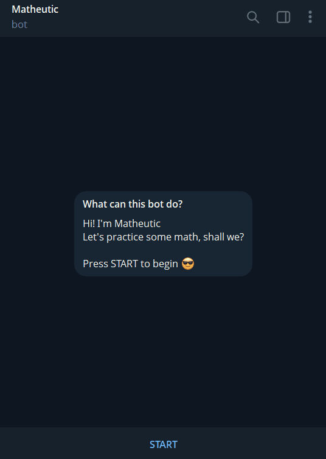
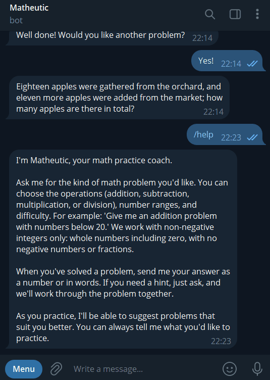
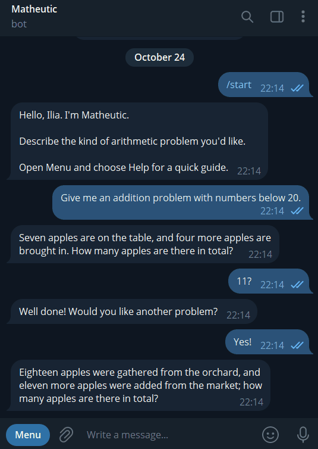

# Matheutic

Matheutic is an arithmetic practice application for children and adults, with printable worksheets and a conversational Telegram Coach.

## Telegram Coach

Practise arithmetic through a conversation: ask for a word problem, send your answer, and get help when you need it. You can choose what to practise and change the difficulty as you go.

### Start practising

1. Open a chat with the Matheutic Coach in Telegram and press **START**, or send `/start`.
2. Ask for a problem, such as “Give me an addition problem with numbers below 20.”
3. Send your answer as a number or in words, such as `5`, `five`, or `I think five`.

The Coach checks your answer. If it is incorrect, you can try again or accept a hint.

Here is how to start a conversation and request a simple problem:

### Choose your practice

You can ask for addition, subtraction, multiplication, division, or a combination. Choose number ranges, the number of calculation steps, an answer limit, and a difficulty from easy to hard. You can also suggest a story theme.

For example:

- “Give me an easy multiplication story with numbers from 1 to 10.”
- “Give me a two-step addition and subtraction problem with numbers below 50.”
- “Make it about animals, with a final answer at most 30.”

Practice uses whole numbers, including zero, with no negative numbers or fractions. Division always gives a whole-number result.

### Get help along the way

Ask for a hint at any time. For problems with several calculation steps, the Coach guides you through one step at a time and checks your answers along the way. You can ask it to repeat or explain a hint, or show the full solution.

This conversation shows a two-step problem and the guidance through it:

### Continue and adjust

Use ordinary messages to control your practice:

| Message | What it does |
| --- | --- |
| “Another one” | Gives you a new problem with the same practice settings. |
| “Another, but division this time” | Changes the kind of problem. |
| “Harder” or “Easier” | Adjusts the difficulty. |
| “Hint” | Helps with the current problem. |
| “Repeat the hint” | Shows the latest hint again. |
| “I give up” | Shows the solution. |
| “Stop” | Ends the current problem. |

Your practice is saved, so you can return to your current problem later. Sending `/start` begins a new session while keeping your learning history.

As you practise, the Coach can suggest changes based on your recent answers. It explains the proposed practice, and you choose whether to accept it. You can also say “I struggle with multiplication” to ask for more focused support.

### Find help

Send `/help` for a short guide to requesting problems, answering, and getting hints:

## Printable worksheets

Matheutic also creates printable PDF worksheets with configurable arithmetic exercises, page layouts, and optional separate answer keys.

Worksheets are currently generated using the command-line interface (CLI) and JSON presets. See [the worksheet developer guide](docs/DEV.md) for installation, preset configuration, PDF generation, and development guidance.

<!-- Adjusted attached gifs 

-->
